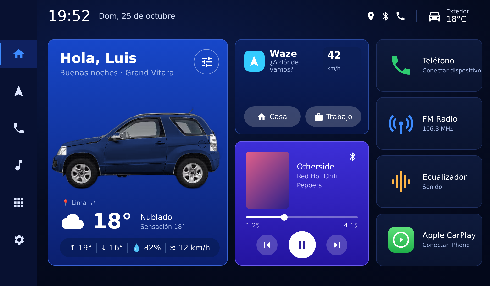
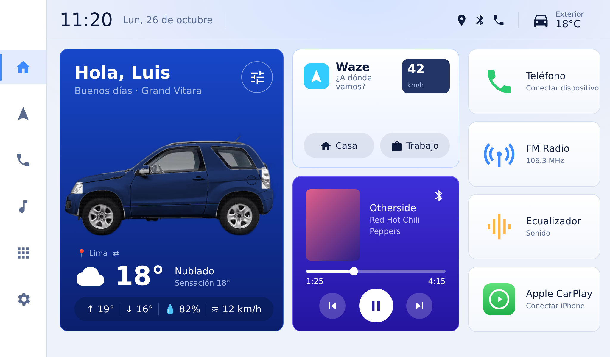
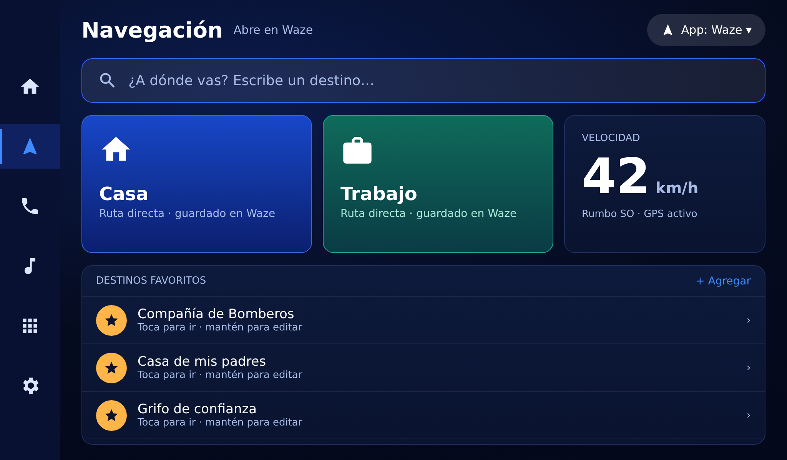
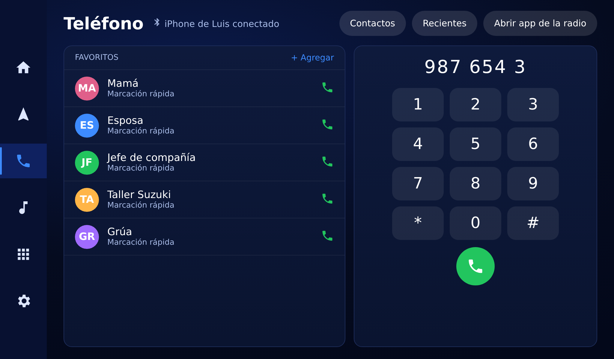
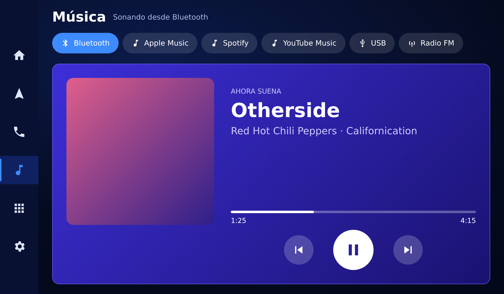
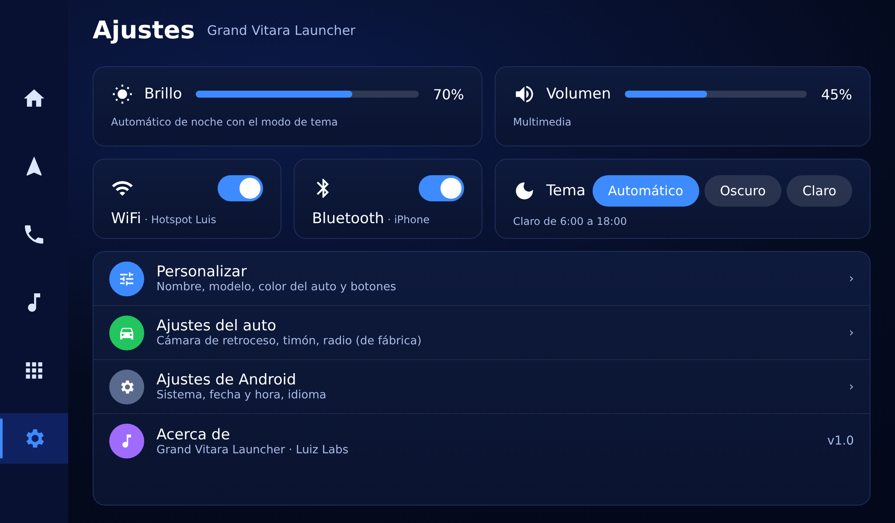
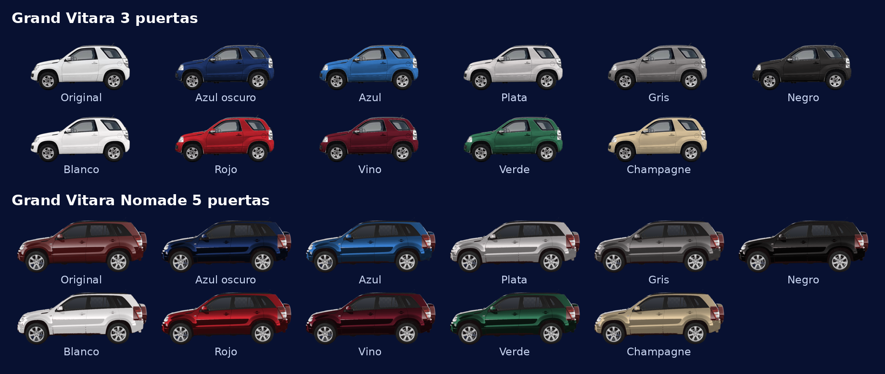

# Grand Vitara Launcher

**Un proyecto de Labs Project** para la comunidad Grand Vitara.

Pantalla de inicio moderna y liviana para las radios Android chinas instaladas en la **Suzuki Grand Vitara**
(probado en radio de 9" con Allwinner T3, 1 GB de RAM, firmware K2001N).



## Qué trae
- Saludo con **tu nombre** y la imagen de **tu Vitara** (3 puertas, 5 puertas o tu propia foto).
- **Cambio de color** del auto: azul oscuro, azul, plata, gris, negro, blanco, rojo, vino, verde y champagne.
- Clima con ubicación automática (necesita internet: WiFi o el hotspot del celular).
- Tarjeta de **Waze** con botones directos a **Casa** y **Trabajo** + velocidad por GPS.
- Control de la música que esté sonando (Spotify, YouTube Music, etc.).
- Accesos a Teléfono, Radio FM, Ecualizador y Apple CarPlay (con dongle Carlinkit / Autokit).
- **Pantallas propias** en la barra lateral:
  - **Navegación**: buscador de destinos, Casa/Trabajo, velocidad y destinos favoritos. Waze o Google Maps (Apple Maps se usa con CarPlay).
  - **Teléfono**: favoritos de marcación rápida y teclado. La llamada la hace la app Bluetooth de la radio.
  - **Música**: reproductor grande y fuentes: Bluetooth, Apple Music, Spotify, YouTube Music, USB y Radio FM.
  - **Ajustes**: brillo, volumen, WiFi, Bluetooth, tema, app de música y de navegación por defecto.
- **Modo oscuro, claro o automático** (claro de día, oscuro de noche para no encandilar).
- Sin mapa propio ni procesos pesados, para que corra en radios de 1 GB.



### Pantallas de la barra lateral
| Navegación | Teléfono |
|---|---|
|  |  |
| **Música** | **Ajustes** |
|  |  |



## Personalizar
En la pantalla de inicio, toca el **ícono de ajustes** de la tarjeta principal (o la imagen del auto):
- **Tu nombre**: aparece en el saludo.
- **Modelo**: 3 puertas, 5 puertas o **Mi foto**.
- **Tema de pantalla**: Automático (claro de 6:00 a 18:00), Oscuro o Claro.
- **Color**: toca una muestra y la vista previa cambia al instante. "Original" deja la foto tal cual (3 puertas blanca, Nomade vino).

**Usar tu propia foto:** queda mejor una foto lateral con **fondo transparente** (PNG).
Puedes quitar el fondo gratis en sitios como remove.bg. Luego en "Mi foto":
- **Elegir foto** abre el selector de archivos de la radio, o
- copia la imagen a la radio como `Download/auto.png` y toca **Usar Download/auto.png**.

## Instalación
Necesitas una laptop con ADB y la radio con **Depuración USB** activada
(Ajustes → Información → 7 toques en "Número de compilación" → Opciones de desarrollador).

1. Descarga el APK desde la pestaña **Actions** (último run con ✓ → Artifacts) o desde **Releases**.
2. Conecta la laptop y la radio a la misma red WiFi y anota la IP de la radio.
3. Desde la carpeta del proyecto:
   ```bash
   bash scripts/instalar.sh IP_DE_LA_RADIO      # instala y lo pone como inicio
   bash scripts/revertir.sh IP_DE_LA_RADIO      # vuelve al launcher original
   ```
   O instala el APK a mano desde una USB y, cuando la radio pregunte, elige **Grand Vitara Launcher → Siempre**.

## Si un botón no abre la app correcta
Cada radio trae apps con nombres distintos. Saca la lista de la tuya con
`bash scripts/listar_apps.sh IP_DE_LA_RADIO` y agrega el paquete correcto en
`launcher/app/src/main/java/com/luis/gvlauncher/Config.kt`. Al subir el cambio, GitHub compila un APK nuevo solo.

## Compilar
No hace falta Android Studio: cada `git push` a `main` compila el APK en GitHub Actions.
Para compilar local: `cd launcher && ./gradlew assembleDebug` (requiere JDK 17 y el SDK de Android).

## Créditos
Desarrollado por **Labs Project**.
